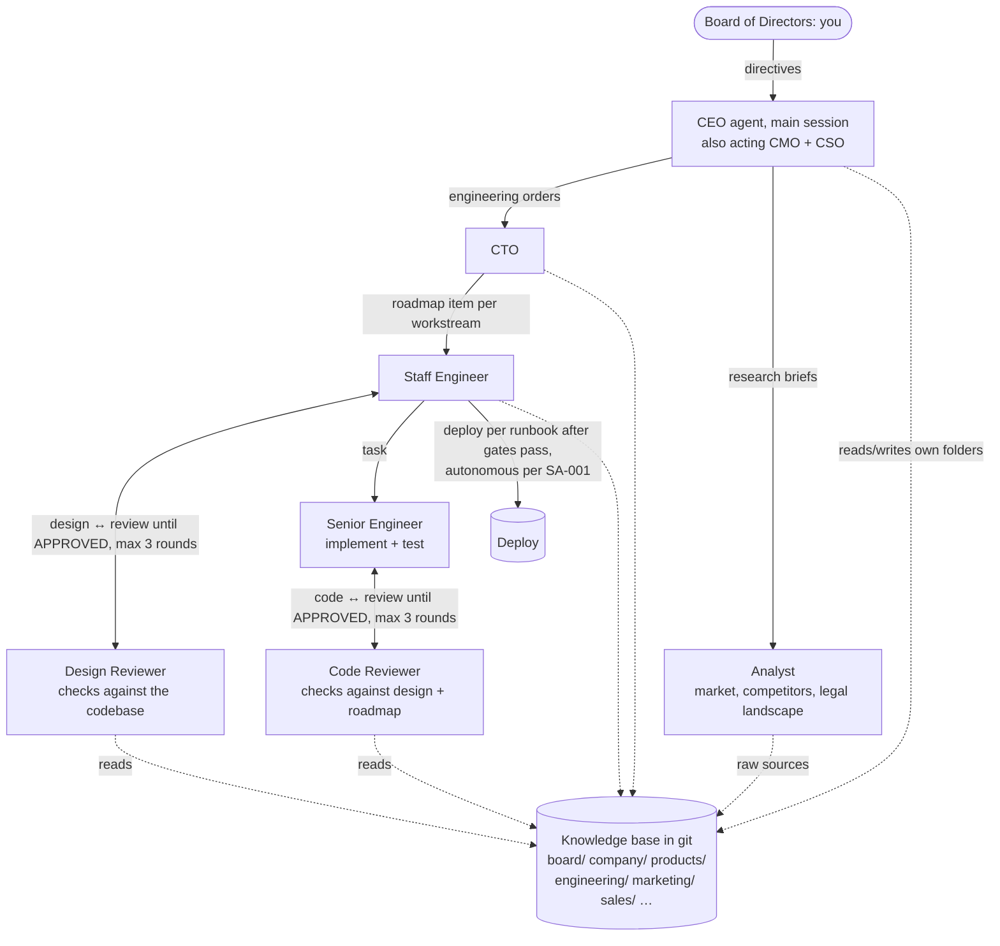

# How to build the agentic company: research and recommendation

| | |
|---|---|
| **Date** | 2026-10-12 |
| **Prepared for** | The founder, acting as the Board of Directors |
| **Status** | **Decided.** Phase 1 was approved and built: it is this repository. Kept as the design rationale |
| **Scope** | Frameworks for a hierarchy of agents (CEO, then departments, then sub-teams) with a shared knowledge base, serving several products |

## TL;DR

1. **Claude Code already does most of this without add-ons.** As of October 2026 the official docs cover:
   - custom role agents;
   - delegation nested three levels below the main session, so CEO → CTO → Staff → Senior/Reviewer fits exactly;
   - running the main session as a chosen agent (`claude --agent ceo`);
   - reusable procedures (skills);
   - deterministic guardrails (hooks and permission rules);
   - repeatable loops such as "implement → review until it passes", written as code in saved *dynamic workflows*;
   - headless and scheduled runs.

   Your doubt would have been right in early 2025. It isn't any more.
2. **LangGraph is a strong orchestration runtime, but it doesn't do the engineering.** It provides durable checkpoints, human-approval pauses at any step, retries, and tracing (via LangSmith). It has no agent that reads a codebase, edits files, runs tests and commits. You would still put a Claude Code-style agent inside each step: LangChain's own *Deep Agents* (its README says it was "primarily inspired by Claude Code"), or the Claude Agent SDK. A LangGraph-first build means writing that infrastructure yourself, with per-token API billing, before the first feature ships.
3. **Recommendation: build v1 inside Claude Code ("the company in a repo"),** with a **markdown knowledge base in git** as the shared memory. Keep agent definitions and knowledge-base files framework-neutral (plain markdown and YAML), so moving to LangGraph or Claude Managed Agents later reuses them. [Section 7](#7-phased-roadmap-and-when-to-adopt-langgraph) lists the conditions that would justify that move.
4. **The org design matters more than the framework.** Published failure analyses ([section 2](#2-lessons-from-teams-that-built-these-systems)) find that multi-agent systems fail mainly through **unclear specs, misalignment between agents and missing verification**, not model weakness. The knowledge base, the written hand-offs, the independent reviewers and the bounded review loops do the real work.

---

## 1. Requirements (restated from the Board's brief)

| # | Requirement | Notes |
|---|---|---|
| R1 | **Hierarchy**: Board (human) → CEO → department heads (CTO now; CMO, CSO, CFO, COO, CPO, legal, HR later) → sub-teams | For now the CEO also covers CMO and CSO |
| R2 | **Shared knowledge base**: each department writes its own folders and reads everyone else's | "Gather info from each other to make correct decisions" |
| R3 | **Engineering pipeline**: CTO roadmap (high-to-mid level) → Staff design docs, reviewed against the **codebase** until approved → Senior implementation and tests, reviewed against the **design and CTO roadmap** until approved → deploy | Two plan ↔ review loops |
| R4 | **Board control**: the CEO turns directives into orders, reports back, and escalates decisions reserved for the Board | The Board can overrule |
| R5 | **Multi-product**: several existing products, with more to follow | Several codebases |
| R6 | **Extensible**: new departments split off from the CEO later without a rewrite | e.g. a separate CMO |
| R7 | **Speed and cost**: speed up development now, at startup cost | First value in days, not months |

## 2. Lessons from teams that built these systems

These principles hold whichever framework we pick.

1. **Hand-offs must carry the full context, in writing.** Cognition (makers of Devin) argued in *Don't Build Multi-Agents* (June 2025) that a sub-agent handed only a summary misreads its task, and that "actions carry implicit decisions": parallel agents that can't see each other's choices build incompatible pieces. Their April 2026 follow-up, *Multi-Agents: What's Actually Working*, says multi-agent setups work when **many agents contribute intelligence but writes stay single-threaded**. → *Design rule: every hand-off is a document in the knowledge base. Each artifact has exactly one writer. Parallelism goes to reading and reviewing, not to several agents writing the same thing.*
2. **Delegate with detailed briefs.** Anthropic's write-up of its multi-agent research system says each sub-agent needs "an objective, an output format, guidance on the tools and sources to use" and clear task boundaries. Vague delegation caused duplicated work. → *Design rule: a standard order format (objective, context links, acceptance criteria, output format, boundaries).*
3. **Put effort-scaling rules in the prompts.** The same post says early versions "spawned 50 subagents for simple queries". → *Design rule: the CEO and CTO prompts say how much delegation a task deserves. Small asks are done directly, without spinning up the whole pipeline.*
4. **Verification is its own failure class.** The MAST study (*Why Do Multi-Agent LLM Systems Fail?*, NeurIPS 2025) catalogues 14 failure modes from over 1,600 annotated traces. They fall into three groups: system-design issues, inter-agent misalignment, and task verification. → *Design rule: reviewers are separate agents with fresh context, read-only access and an explicit checklist. Every loop has a pass condition and a maximum number of rounds, after which it escalates.* Anthropic's Managed Agents "outcomes" feature uses the same pattern: a separate grader with its own context window.
5. **Save the plan outside the context window and make work resumable.** Anthropic saves the plan to external memory and built recovery that "can resume from where the agent was when the errors occurred". → *Design rule: roadmaps, designs and status live in files, so any agent can restart from the knowledge base.*
6. **Multi-agent work costs a lot.** Anthropic measured about **15× more tokens than chat** and found token usage alone explained 80% of the performance variance. Their multi-agent setup beat a single agent by 90.2% on research tasks. → *Design rule: use the full pipeline for valuable work. Measure cost per directive from day one.*
7. **Start evaluating early with a small set.** Anthropic began with about 20 test queries. → *Design rule: keep 10–20 representative Board directives as a regression set for the org's prompts.*

## 3. Options evaluated

### 3.1 Claude Code, built-in features only

Each requirement maps to a documented feature (sources: `code.claude.com/docs/en/sub-agents`, `/skills`, `/workflows`, `/agent-teams`, `/headless`):

| Need | Claude Code feature | How it works |
|---|---|---|
| A CEO the Board talks to | **Main session as an agent**: `claude --agent ceo`, or `"agent": "ceo"` in `.claude/settings.json` | The CEO's prompt replaces the default system prompt. `tools: Agent(cto, analyst)` limits which agents it may delegate to (this applies only to the main session) |
| Departments and roles | **Custom subagents**: `.claude/agents/**/*.md` (subfolders allowed, so `agents/engineering/cto.md`) | Front matter sets `tools`, `disallowedTools`, `model`, `effort`, `permissionMode`, `maxTurns`, `skills`, `hooks`, `memory`, `isolation: worktree` |
| CEO → CTO → Staff → Senior | **Nested subagents**, "up to three layers below the main conversation" by default | CEO (main) → CTO (1) → Staff (2) → Senior/Reviewer (3) fits exactly. The limit is set by `CLAUDE_CODE_MAX_SUBAGENT_SPAWN_DEPTH`. In interactive sessions, a subagent that launches background subagents "waits for their results before it finishes" |
| Department procedures | **Skills**: `.claude/skills/<name>/SKILL.md` | Loaded on demand or invoked by the Board as `/name`. `context: fork` plus `agent: cto` runs a skill as the CTO |
| Loops that must be deterministic (implement ↔ review until pass, max N rounds) | **Dynamic workflows**: JavaScript with `agent()`, `parallel()`, `pipeline()`, saved to `.claude/workflows/` and run as `/name` | The script, not the model, controls the loop. Results stay in script variables. Runs resume within a session. Up to 16 agents run at once and 1,000 per run. **No mid-run user input**, so Board sign-offs become stage boundaries |
| Guardrails (no secrets in the KB, no force-push, approval before production deploys) | **Hooks** (a `PreToolUse` command exits with code 2 to block) and **permission rules** (`deny` beats `allow`) | Enforced by the runtime, not by the model's goodwill |
| Peers that debate (e.g. three reviewers challenging each other) | **Agent teams** (experimental, `CLAUDE_CODE_EXPERIMENTAL_AGENT_TEAMS=1`) | Shared task list and messaging. No nested teams, and no resume for in-process teammates. *Not needed in v1* |
| Unattended runs (nightly reports, CI) | **Headless mode**: `claude -p ... --agent ceo --output-format json` | JSON output includes `total_cost_usd`. `--max-budget-usd` caps spend. Fits GitHub Actions and cron |

**What it lacks:**
- No dashboard of all running work across days. Status lives in KB files, git and PRs.
- Workflow runs resume only within the same session (or a resumed one). Unlike LangGraph checkpoints in Postgres, they are not durable across machines.
- Human approval can't pause a running workflow. Approvals have to sit between stages.
- The nesting depth fits the current org with no headroom. A deeper org needs workflows for the lower levels, or a higher depth limit.
- A headless gotcha: in `-p` mode "the launching subagent doesn't wait" for nested *background* subagents. Headless runs should force foreground subagents (`CLAUDE_CODE_DISABLE_BACKGROUND_TASKS=1`) or use workflows.

**Billing:** interactive use counts against the Claude subscription. Headless `--bare` runs and the Agent SDK use an API key, billed per token.

### 3.2 Claude Agent SDK (Python `claude-agent-sdk` 0.2.165, TypeScript)

This is Claude Code as a library: the same built-in tools, subagents, hooks, sessions and skills, plus extras. Verified on the installed package:
- `ClaudeAgentOptions` takes `cwd`, `system_prompt` (including `{"type": "file", "path": ...}`), `agents`, `setting_sources`, `permission_mode`, `max_budget_usd`, `effort`, `output_format` (JSON schema) and `hooks`;
- `ResultMessage` reports `total_cost_usd`, `structured_output` and `session_id`.

It is the natural "engineering worker" to call from any external orchestrator, LangGraph included. Billing is per token with an API key. Anthropic's terms bar offering claude.ai logins to third parties, which doesn't apply to internal use.

### 3.3 Claude Managed Agents (beta, `managed-agents-2026-04-01`)

Anthropic hosts both the agent loop and a per-session sandbox:
- **Memory stores**: files mounted under `/mnt/memory/`, at most 100 kB each and 10,000 per store. Every change is versioned for audit, and stores can be `read_only` or `read_write`.
- **Outcomes**: a separate grader iterates the agent against a rubric.
- **Scheduled deployments**: cron-style runs.
- **Webhooks**, and **vaults** for credentials.
- **Multi-agent**: subagent delegation is **one level deep**, with at most 25 child threads. Dynamic workflows are available too.

This fits always-on department agents later, for example a nightly marketing content run. Memory stores use the same file-and-path shape as our markdown knowledge base, so migrating is a copy. It's beta, billed per token, and harder to iterate on than files in a repo.

### 3.4 LangGraph 1.2 (plus Deep Agents and LangSmith)

**Versions verified on PyPI on 2026-10-12:**
- `langgraph` 1.2.14, released 2026-10-06;
- `langgraph-checkpoint` 4.2.0;
- `deepagents` 0.7.24, released 2026-10-12;
- `langgraph-supervisor` 0.0.31, last released 2025-11-19. Its README now says: "We now recommend using the supervisor pattern directly via tools rather than this library."

**Strengths, verified in the installed package:**
- An explicit graph state machine (`StateGraph`, conditional edges).
- **Durable checkpoints**: `compile(checkpointer=...)`, with SQLite or Postgres in production.
- **Human-in-the-loop at any node**: `interrupt(value)` pauses the run and `Command(resume=...)` continues it from the checkpoint, even days later.
- `RetryPolicy` and a long-term memory `Store`.
- Model-agnostic, MIT-licensed, with first-class tracing and deployment through LangSmith.

**Proof of concept:** our exact pipeline in about 100 lines, run locally with stubbed agents ([Appendix A](#appendix-a-langgraph-proof-of-concept-tested)). It covers the CEO → CTO → Staff design loop (fails once, then passes) → Senior ↔ code-review loop → **Board approval pause** → deploy, resumed from the checkpoint. It worked first try. The topology is easy.

**Weaknesses for us right now:**
- It's an orchestrator, not a worker. Each node still needs a coding agent with file, shell, git and test tools, a sandbox and permission handling. That means Deep Agents (Claude Code-inspired, model-agnostic) or the Claude Agent SDK inside nodes ([Appendix B](#appendix-b-claude-agent-sdk-inside-a-langgraph-node-sketch)).
- More to own: the state schema, the checkpoint database, deployment, observability, secrets and sandboxing.
- Everything is billed per token. LangSmith tracing and deployment add a bill. Third-party sources report a mid-2026 repricing to usage units, so check the official pricing page before relying on any figure.
- LangChain's own direction (recommending tool-calling supervisors, building Deep Agents to copy Claude Code) points toward the same shape as option 3.1, not away from it.

**Where it wins:** long-running business processes with many human approvals and strict audit needs. Examples: a sales pipeline with deal approvals, finance and legal flows, or many concurrent directives that each need a dashboard and replay.

### 3.5 Other frameworks (one-line verdicts)

| Framework (PyPI version, 2026-10) | What it offers | Verdict for us |
|---|---|---|
| **CrewAI** 1.15.27 | "Crews" of role agents, a *hierarchical process* with an automatic manager, and "Flows" for event-driven control | The closest "company" metaphor, but no built-in coding harness and less control than LangGraph. Skip |
| **OpenAI Agents SDK** 0.23.1 | Handoffs, agents as tools, guardrails, sessions, tracing | Built around OpenAI. Skip |
| **Microsoft Agent Framework** 1.21.0 | Sequential, concurrent, group-chat, handoff and "Magentic" orchestrations | Leans toward Azure and .NET. Skip |
| **Google ADK** 2.11.0 | Composes agents "into flexible hierarchies" | Leans toward GCP. Skip |
| **MetaGPT** 0.8.2 (last release 2025-03) | The original "software company as agents" (product manager, architect, engineer, QA, driven by SOPs) | Stale. Useful only as prior art for role SOPs |
| **Paperclip** (open source, third-party reports) | An "orchestration for zero-human companies" server: org charts, **per-agent monthly budgets**, scheduled "heartbeats", tasks handed to coding agents such as Claude Code | Unverified maturity. **Worth borrowing two ideas**: per-agent budgets and heartbeats |

### 3.6 Scorecard against the requirements

● strong, ◐ partial, ○ weak/none.

| | Claude Code built-in | Agent SDK | Managed Agents | LangGraph + Deep Agents/SDK | CrewAI |
|---|---|---|---|---|---|
| R1 hierarchy | ● (3 levels) | ● | ◐ (1 level) | ● (any depth) | ◐ |
| R2 shared KB | ● files in git | ● | ● memory stores | ◐ Store/RAG (build it) | ◐ |
| R3 coding loops against a real codebase | ● | ● | ● | ◐ (needs a worker) | ○ |
| R4 Board control and approvals | ◐ (stage gates, hooks) | ◐ (callbacks) | ◐ (permission policies) | ● (`interrupt`) | ◐ |
| R5 multi-repo | ● | ● | ● | ● | ◐ |
| R6 add departments | ● (add a markdown file) | ● | ● | ◐ (code change) | ◐ |
| R7 time to first value | **days** | 1–2 weeks | 1–2 weeks | 3–6 weeks | 2–3 weeks |
| Durable, resumable runs across machines | ◐ | ◐ | ● | ● | ◐ |
| Ops overhead | none | low | low | medium–high | medium |

## 4. Knowledge base options

| Option | Strengths | Weaknesses | Use |
|---|---|---|---|
| **Markdown in git** (Karpathy's "LLM wiki" pattern, April 2026: an LLM-maintained, cross-linked markdown wiki, plus raw sources, plus a schema file such as CLAUDE.md) | You can read and diff it. Agents use it with plain Read and grep. Every change is a reviewable commit. No infrastructure | No semantic search at large scale (mitigated by index pages and front matter) | **v1, the source of truth** |
| Vector search (RAG) over documents | Fuzzy recall over large unstructured corpora | Opaque, goes stale, retrieves chunks rather than decisions | Later, as a tool for big corpora (support tickets, legal texts, visa rules) |
| Temporal knowledge graph (Graphiti 0.30, Zep) and agent-memory products (Mem0 2.2, Letta 0.34) | Entities, relationships, facts that change over time | Infrastructure and complexity | Later, for CRM-like data (customers, deals) |
| Managed Agents memory stores | Hosted, versioned, auditable, same file shape | Beta, API-only | Migration target if agents move to hosted runs |
| LangGraph `Store` | Namespaced JSON documents, optional semantic search | Tied to LangGraph | Only if LangGraph is adopted |

**Recommended rules for the knowledge base:**
- **One owner per folder.** Each department writes only its own tree and reads everything.
- **Front matter on every document**: `owner`, `status`, `updated`, `related`.
- **Decision records** (ADR style) for company and architecture decisions.
- **Separate raw sources** (web research, imports) **from curated pages.** This limits prompt injection: content fetched from the web never becomes "trusted memory" until an owner curates it. The Managed Agents memory docs warn about exactly this.
- **A linter in CI** for front matter, broken links and stale pages, plus a hook that blocks secrets from being written into the knowledge base.

## 5. Recommended architecture (v1)



**Repository layout (framework-neutral by design):**

```
agentic-company/
├── CLAUDE.md                   # the constitution: org, chain of command, KB rules, Board-reserved decisions
├── knowledge/                  # the company's knowledge base, one folder per owner
│   ├── board/                  # directives (verbatim) and standing authorizations
│   ├── company/                # mission, portfolio, strategy, decision log
│   ├── products/<product>/     # facts per product: users, features, repos, metrics
│   ├── engineering/            # architecture, standards, roadmaps, designs, ADRs, runbooks
│   ├── marketing/  sales/      # owned by the CEO for now; becomes the CMO's and CSO's
│   └── finance/ legal/ people/ operations/   # placeholders until those departments exist
├── .claude/
│   ├── agents/executive/       # ceo.md, analyst.md
│   ├── agents/engineering/     # cto.md, staff-engineer.md, senior-engineer.md, design-reviewer.md, code-reviewer.md
│   ├── skills/                 # /directive, /report, /onboard-company, /onboard-codebase, marketing & sales playbooks
│   ├── workflows/              # saved deterministic loops (design-review loop, implement-review loop)
│   └── settings.json           # "agent": "ceo", permission rules, hooks
├── scripts/                    # KB linter, hook scripts
└── workspaces/                 # product repos cloned here (gitignored)
```

**Engineering pipeline in detail:**
1. **The CEO writes an order** containing the objective, Board directive link, product, constraints, acceptance criteria and deadline.
2. **The CTO** reads `products/<x>/`, `engineering/architecture/` and the relevant marketing and sales context. It writes `engineering/roadmaps/RM-…md` with milestones, plus workstreams that each have acceptance criteria.
3. **For each workstream, a Staff engineer** writes `engineering/designs/DD-…md`, grounded in the actual code (`workspaces/<repo>`).
4. **The design reviewer** checks the design against the codebase (do the modules and integration points really exist?), the roadmap's acceptance criteria and the standards. It returns `APPROVED` or `CHANGES_REQUESTED` with numbered, severity-ranked findings. The loop runs at most 3 rounds, then escalates to the CTO.
5. **For each task, a Senior engineer** works on a branch with tests.
6. **The code reviewer** checks the diff against the design, the roadmap and the definition of done, and runs the tests. This loop also runs at most 3 rounds.
7. **Deploy.** Autonomous under standing authorization SA-001, granted by the Board on 2026-10-12. It requires tests green, the review APPROVED, a runbook with a smoke check and rollback, and a report to the Board afterwards.
8. **Reports flow back up** in a fixed format: status, artifacts, decisions, open questions, risks. The CEO updates `board/directives/…` and reports to the Board.

**Cross-department information** (R2): agents read any folder. Missing information goes up as an "open question" in a report, and the common manager answers it. Today that is the CEO, wearing the CMO/CSO hat, who writes the answer into the knowledge base. That's how a company works too: departments read each other's docs and escalate conflicts to a shared boss.

## 6. Cost

API list prices (USD per million tokens, from Anthropic's current model table):

| Model | Input | Output | Cache read |
|---|---|---|---|
| Claude Fable 5.1 (most capable) | $10.00 | $50.00 | $0.25 |
| Claude Opus 5.5 | $4.00 | $20.00 | $0.20 |
| Claude Sonnet 5.5 | $2.00 | $10.00 | $0.20 |
| Claude Haiku 5.5 | $0.10 | $0.50 | – |

**Illustrative estimate for one feature-sized directive.** These are assumptions, not measurements:
- **Workload:** one roadmap, two design rounds, three implementation tasks with one fix round each, and six code reviews.
- **Opus 5.5 agents** (leadership and reviewers): about 7.5M input tokens and 125k output tokens.
- **Sonnet 5.5 seniors:** about 6M input tokens and 150k output tokens.
- **Caching:** about 85% of input is served from cache.

Total: **about $13**. Thinking tokens (billed as output) and cache-write premiums could plausibly double that, so budget **$10–40 per feature-sized directive**, and much less for small asks the CEO or CTO handles directly. On a Claude Max subscription, interactive runs draw on plan limits instead of a bill, and heavy multi-agent days hit those limits sooner.

**Controls:**
- `--max-budget-usd` and `max_budget_usd` per run;
- `maxTurns` per agent;
- Sonnet for implementation and Opus for judgment;
- logging `total_cost_usd` per directive into the knowledge base;
- borrowing Paperclip's idea of a monthly budget per agent.

## 7. Phased roadmap, and when to adopt LangGraph

| Phase | Timing | What | Exit criteria |
|---|---|---|---|
| **1. Company in a repo** | Week 1 | KB skeleton and conventions, CEO, analyst, the CTO sub-system (CTO, Staff, Senior, two reviewers), skills, hooks, KB linter in CI. Onboarding interviews fill in company and product facts; `/onboard-codebase` maps each repo | The Board issues a directive, and a reviewed PR exists for a real product change |
| **2. Harden** | Weeks 2–4 | Save the two review loops as dynamic workflows (deterministic, bounded). A regression set of 10–20 directives. Cost logging per directive. Headless runs in GitHub Actions for scheduled reports | Three directives in a row delivered without manual rescue. Known cost per directive |
| **3. Split departments** | When marketing and sales volume justifies it | Promote the CEO's marketing and sales playbooks into CMO and CSO agents with their own sub-teams. Add finance, legal and hiring as needed | The CEO's prompt shrinks back to orchestration |
| **4. Durable orchestration** (LangGraph or Managed Agents) | Only when a trigger below fires | Wrap the same agent prompts and KB in LangGraph nodes that call the Claude Agent SDK, or move them to Managed Agents (KB to memory stores, review loops to outcomes) | – |

**Triggers that justify phase 4:**
- several directives running concurrently for days, which need a status dashboard and replay;
- approvals that must happen in the middle of runs, possibly from a phone;
- compliance-grade audit trails;
- non-engineering processes with many human steps, such as a sales pipeline;
- a need to mix model providers.

## 8. Risks and mitigations

| Risk | Mitigation |
|---|---|
| Runaway spend | Per-run budget caps, `maxTurns`, round limits on loops, cost logged per directive |
| Broken code reaches users | Independent reviewers, tests required, production deploys gated by a Board authorization per product, a rollback runbook |
| Context lost at hand-offs | Every hand-off is a knowledge-base document. Fixed order and report formats |
| Prompt injection from web research ends up in "memory" | Raw sources kept apart from curated pages. Only owners curate. Secret-blocking hook. The Board reviews KB diffs in PRs |
| Depth limit (3 levels) | The current org fits. Lower levels move into workflows, or the limit is raised, if the org deepens |
| Vendor lock-in | Prompts and KB are plain markdown. The phase 4 options reuse them unchanged |
| Experimental features change | Avoid agent teams in v1. Rely on stable subagents, skills and hooks. Workflows only for loops |

## 9. Decisions for the Board

1. **Approach:** approve phase 1 inside Claude Code, with LangGraph deferred behind the phase 4 triggers. *(Recommended.)* The alternative is to start with LangGraph now and accept 3–6 weeks of infrastructure before the first feature.
2. **Billing:** use the Claude subscription for interactive use, and an API key with a monthly cap for headless and scheduled runs.
3. **Production deploys:** require Board approval per release until you grant a standing authorization per product. *(Recommended.)*
4. **Repository access:** which repos make up each product, and should agents clone them into `workspaces/` (gitignored)?
5. **Onboarding:** set aside about 30 minutes for the CEO agent's onboarding interview. I couldn't reach either product's website from this environment, so product facts need to come from you rather than be guessed.

**The Board's answers (2026-10-12):**
1. **Approved:** phase 1 inside Claude Code.
2. **Use the Claude subscription as much as possible.** Pay-per-token API usage is too expensive, so no Agent SDK, LangGraph or `--bare` paths for now.
3. **No Board approval needed for production deploys.** This is standing authorization SA-001, with safety enforced by the pipeline's gates.
4. **Repositories:** cloned into `workspaces/` on demand by `/onboard-codebase`.

---

## Appendix A: LangGraph proof of concept (tested)

Run on 2026-10-12 with `langgraph==1.2.14`. Agent calls are stubbed; [Appendix B](#appendix-b-claude-agent-sdk-inside-a-langgraph-node-sketch) shows a real one.

```python
import operator
from typing import Annotated, TypedDict
from langgraph.checkpoint.memory import InMemorySaver
from langgraph.graph import END, START, StateGraph
from langgraph.types import Command, interrupt

MAX_ROUNDS = 3

class State(TypedDict, total=False):
    directive: str
    design_round: int
    design_verdict: str
    code_round: int
    code_verdict: str
    log: Annotated[list[str], operator.add]

def ceo(s):           return {"log": [f"CEO: order to CTO for '{s['directive']}'"]}
def cto(s):           return {"log": ["CTO: roadmap RM-1"]}
def staff_design(s):
    n = s.get("design_round", 0) + 1
    return {"design_round": n, "log": [f"Staff: design v{n}"]}
def design_review(s):
    v = "APPROVED" if s["design_round"] >= 2 else "CHANGES_REQUESTED"   # fails once
    return {"design_verdict": v, "log": [f"Reviewer: design {v}"]}
def senior_impl(s):
    n = s.get("code_round", 0) + 1
    return {"code_round": n, "log": [f"Senior: implementation round {n}"]}
def code_review(s):   return {"code_verdict": "APPROVED", "log": ["Reviewer: code APPROVED"]}
def board_gate(s):    return {"log": [f"Board: {interrupt({'ask': 'Deploy to production?'})}"]}
def deploy(s):        return {"log": ["Senior: deployed"]}
def escalate(s):      return {"log": ["Escalated to CTO after max review rounds"]}

def after_design(s):
    if s["design_verdict"] == "APPROVED": return "senior_impl"
    return "staff_design" if s["design_round"] < MAX_ROUNDS else "escalate"
def after_code(s):
    if s["code_verdict"] == "APPROVED": return "board_gate"
    return "senior_impl" if s["code_round"] < MAX_ROUNDS else "escalate"

g = StateGraph(State)
for fn in (ceo, cto, staff_design, design_review, senior_impl, code_review, board_gate, deploy, escalate):
    g.add_node(fn.__name__, fn)
g.add_edge(START, "ceo"); g.add_edge("ceo", "cto"); g.add_edge("cto", "staff_design")
g.add_edge("staff_design", "design_review"); g.add_conditional_edges("design_review", after_design)
g.add_edge("senior_impl", "code_review"); g.add_conditional_edges("code_review", after_code)
g.add_edge("board_gate", "deploy"); g.add_edge("deploy", END); g.add_edge("escalate", END)

app = g.compile(checkpointer=InMemorySaver())   # PostgresSaver in production
cfg = {"configurable": {"thread_id": "directive-001"}}
first = app.invoke({"directive": "Add mock-exam mode to the product"}, cfg)
print("paused at:", first["__interrupt__"][0].value)
print("\n".join(app.invoke(Command(resume="approved"), cfg)["log"]))
```

Output:

```
paused at: {'ask': 'Deploy to production?'}
CEO: order to CTO for 'Add mock-exam mode to the product'
CTO: roadmap RM-1
Staff: design v1
Reviewer: design CHANGES_REQUESTED
Staff: design v2
Reviewer: design APPROVED
Senior: implementation round 1
Reviewer: code APPROVED
Board: approved
Senior: deployed
```

## Appendix B: Claude Agent SDK inside a LangGraph node (sketch)

The option names and types were checked against `claude-agent-sdk==0.2.165`. The code was not run, because this environment has no API key. It shows how phase 4 would reuse the same agent prompt files used in v1.

```python
from claude_agent_sdk import ClaudeAgentOptions, ResultMessage, query

VERDICT = {"type": "json_schema", "schema": {
    "type": "object", "required": ["verdict", "findings"],
    "properties": {"verdict": {"enum": ["APPROVED", "CHANGES_REQUESTED"]},
                   "findings": {"type": "array", "items": {"type": "string"}}}}}

async def code_review(state):
    opts = ClaudeAgentOptions(
        cwd=f"workspaces/{state['repo']}",
        # same role prompt the v1 Claude Code subagent uses (strip its front matter in a real build)
        system_prompt={"type": "file", "path": ".claude/agents/engineering/code-reviewer.md"},
        allowed_tools=["Read", "Grep", "Glob", "Bash(git diff *)", "Bash(npm test *)"],
        permission_mode="dontAsk", model="claude-opus-5-5",
        max_budget_usd=3.0, output_format=VERDICT,
    )
    async for msg in query(prompt=f"Review branch {state['branch']} against {state['design_doc']}", options=opts):
        if isinstance(msg, ResultMessage):
            out = msg.structured_output
            return {"code_verdict": out["verdict"], "findings": out["findings"],
                    "cost": state.get("cost", 0) + (msg.total_cost_usd or 0)}
```

## Sources

**Primary documentation (fetched 2026-10-12):**
- Claude Code: [Subagents](https://code.claude.com/docs/en/sub-agents) · [Skills](https://code.claude.com/docs/en/skills) · [Dynamic workflows](https://code.claude.com/docs/en/workflows) · [Agent teams](https://code.claude.com/docs/en/agent-teams) · [Headless / programmatic](https://code.claude.com/docs/en/headless) · [Permissions](https://code.claude.com/docs/en/permissions) · [Agent SDK overview](https://code.claude.com/docs/en/agent-sdk/overview)
- Claude Platform: [Managed Agents overview](https://platform.claude.com/docs/en/managed-agents/overview) · [Multiagent orchestration](https://platform.claude.com/docs/en/managed-agents/multiagent-orchestration) · [Memory stores](https://platform.claude.com/docs/en/managed-agents/memory)
- Package metadata and READMEs from PyPI: [langgraph](https://pypi.org/project/langgraph/) · [deepagents](https://pypi.org/project/deepagents/) · [langgraph-supervisor](https://pypi.org/project/langgraph-supervisor/) · [claude-agent-sdk](https://pypi.org/project/claude-agent-sdk/) · [crewai](https://pypi.org/project/crewai/) · [openai-agents](https://pypi.org/project/openai-agents/) · [agent-framework](https://pypi.org/project/agent-framework/) · [google-adk](https://pypi.org/project/google-adk/) · [metagpt](https://pypi.org/project/metagpt/) · [graphiti-core](https://pypi.org/project/graphiti-core/) · [mem0ai](https://pypi.org/project/mem0ai/) · [letta](https://pypi.org/project/letta/)

**Research and engineering write-ups:**
- [Anthropic: How we built our multi-agent research system](https://www.anthropic.com/engineering/multi-agent-research-system)
- [Cognition: Don't Build Multi-Agents](https://cognition.ai/blog/dont-build-multi-agents) · [Cognition: Multi-Agents: What's Actually Working](https://cognition.ai/blog/multi-agents-working) (both summarized from search results; the site couldn't be fetched from this environment)
- [Cemri et al., Why Do Multi-Agent LLM Systems Fail? (MAST), NeurIPS 2025](https://arxiv.org/abs/2503.13657)
- [LangChain: How and when to build multi-agent systems](https://www.langchain.com/blog/how-and-when-to-build-multi-agent-systems)

**Secondary sources (lower confidence):**
- Karpathy's LLM wiki pattern: [aibuilderclub summary](https://www.aibuilderclub.com/blog/karpathy-llm-wiki), [pebblous report](https://blog.pebblous.ai/report/karpathy-llm-wiki/en/)
- Paperclip: [docs](https://paperclip.ing/docs), [gittrend listing](https://gittrend.io/repo/paperclipai/paperclip)
- LangSmith pricing: [metacto](https://www.metacto.com/blogs/the-true-cost-of-langsmith-a-comprehensive-pricing-integration-guide), [usagepricing](https://usagepricing.com/blueprint/langsmith) (conflicting; verify on the official page)
- LangGraph interrupt patterns: [rentierdigital](https://rentierdigital.xyz/blog/human-in-the-loop-langgraph)
